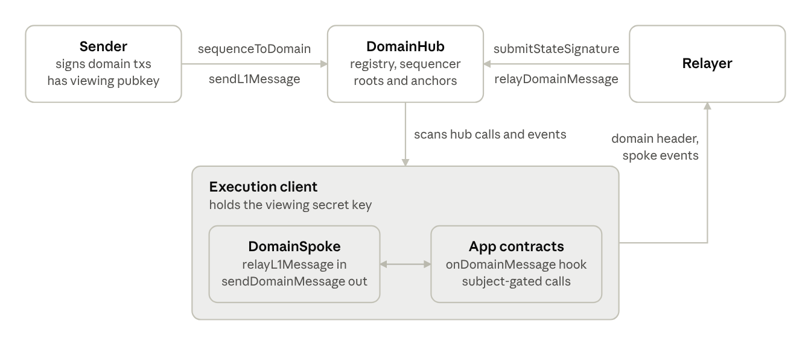

# Monad Domains Protocol

## Overview

A domain is a private execution environment whose transactions are ordered by the Monad L1 but whose contents only the domain's execution clients can read. Every domain transaction is submitted to the L1 as ciphertext, the L1 orders it, and the domain client decrypts and executes it off the L1's critical path.

The core protocol and its actors are as follows:

| Component | Where | Role |
| --- | --- | --- |
| DomainHub | L1, one instance | Registry of domains (validator set, quorum, fee recipient, viewing public key, checkpoint interval), transaction sequencer inbox, store of attested state roots and outbound message anchors, L1 inbox and outbox for messages |
| DomainSpoke | One instance at each domain | Receives L1-origin messages as system transactions, records domain-origin messages by nonce, holds the access-control rules the client enforces |
| Domain execution client | Off-chain, per domain | Modified Monad node. Derives the domain's blocks from hub events, decrypts payloads with the viewing secret key, executes, serves the domain header |
| Validators | Off-chain keys, one per replica | Sign checkpoints: the domain state root at a scheduled L1 height together with the root of the domain-origin messages recorded since the previous checkpoint. The hub advances once a quorum signed the same checkpoint |



Senders and validators only ever talk to the hub. The client reads the hub to derive every domain block, and validators carry domain headers and message anchors back up.

End to end: a sender encrypts a signed domain transaction to the domain's viewing key and hands the ciphertext to the hub. The domain client sees the sequencing event, decrypts, and executes the transaction in the next domain block. For message passing from domain -> L1, every validator independently signs the next scheduled checkpoint, whose anchor is the Merkle root of the messages recorded since the previous one. Once the hub holds a quorum of signatures anyone can prove a message against the anchor and have the hub execute or forward it. Messages from L1 to a domain need no proof. The hub records them as events and the client injects one system transaction per event.

## Registering a domain

A domain is identified by its chain ID. A domain is created by calling `registerDomain(domainChainId, validators, quorum, feeRecipient, viewingKey, checkpointInterval)` on the hub. Starting a domain should include the following three steps:

1. **Generate the viewing keypair.** A P-256 key. The secret key goes to every execution client that will serve the domain. The public key is registered on the hub and used by users to encrypt domain transactions.
2. **Configure the execution clients.** Each replica is started with the domain's chain ID, the address its spoke will have, and the key file, plus the hub address as the sequencer contract. Every replica must hold the same secret key to decrypt the ciphertext.
3. **Deploy the spoke inside the domain.** The spoke is a contract in the domain's own state, not on the L1. Its creation transaction is sequenced through the hub like any other domain transaction.

## Transactions and Message passing

Everything that enters a domain is pushed by the protocol from L1 events.

**Sequenced transactions.** A domain transaction is an ordinary EIP-1559 transaction signed with the domain chain ID, with zero value. Its encrypted bytes are passed to `sequenceToDomain` on the hub with a fee, which the hub forwards to the domain's fee recipient. The fee buys `fee / DOMAIN_GAS_PRICE` gas, capped at the L1 block gas limit, and the transaction executes only if its gas limit is within that. The execution client derives the transactions of each L1 block from the hub's `DomainTransactionSequenced` events in its receipts, decrypts them, and executes all eligible ones as one gasless domain block against the domain state at the parent L1 height. No gas is charged on the domain.

**Fees.** Every sequencing and message call pays its fee in the L1 native token at the hub's fixed `DOMAIN_GAS_PRICE`, which the execution client mirrors. The hub sells at most `DOMAIN_BLOCK_GAS_LIMIT` gas per domain per L1 block, across sequencing and messages; a call that would exceed it reverts.

**L1 to domain messages.** A call to `sendL1Message` on the hub records an event carrying the target, the payload and the fee, which must be at least `minDeliveryFee(payload length)`. The execution client derives one system transaction per event, with the gas the fee bought as its gas limit, and calls `relayL1Message` on the spoke. The spoke forwards all but `DELIVERY_GAS_RESERVE` of that gas to the target, so a target that fails or runs out of gas is still recorded as failed. Anyone can retry a failed message with `retryL1Message` and a higher gas limit.

**Domain to L1 messages.**

1. A domain contract calls `sendDomainMessage(destinationChainId, to, data)` on the spoke. The spoke builds an envelope of source chain, destination chain, sender, target and the payload.
2. A batch is defined by two consecutive checkpoints: the message IDs recorded between them, in nonce order, are the leaves of a merkle tree whose root is the anchor. The tree hashes sorted pairs with keccak256, so proofs verify with OpenZeppelin `MerkleProof`, and promotes an odd node unchanged to the next level; a single message is its own root.
3. Validators sign the anchor together with the state root. Once a quorum signed, the hub records the anchor.
4. Anyone calls `relayDomainMessage(message, anchor, proof)` on the hub to execute the message. A message to another domain is queued there as an L1 to domain message instead, and the caller attaches its delivery fee.

## Checkpoint attestation

Validators attest checkpoints on a schedule. The hub accepts a checkpoint height that is a multiple of the domain's `checkpointInterval`, above the hub's last attested height.

Each validator signs the EIP-712 digest the hub defines, with domain `{name: "MonadDomainHub", version: "1", chainId: l1ChainId, verifyingContract: hub}` and the struct

```
StateTransition(
    uint64  domainChainId,
    uint256 stateNonce,         // the hub's current per-domain transition counter
    uint64  domainBlockNumber,  // the checkpoint's L1 height
    bytes32 newStateRoot,       // domain state root at that height
    bytes32 domainAnchor        // Merkle root of the batch, or zero
)
```

## Input queue

Every sequenced transaction and recorded message is also appended, in L1 order, to the destination domain's input queue in the hub's storage. The queue holds every input the domain's last attested state does not yet cover, so a node that has the L1 state and the domain state at the attested height reaches the domain's tip by replaying the queue, without L1 receipts or blocks older than its L1 sync target.

**Bound.** The queue is a circular buffer of `INPUT_QUEUE_CAPACITY` 32-byte words (2 MiB). A call that would overwrite an unreleased input reverts with `InputQueueFull`. An attestation at height `h` releases the inputs of every L1 block up to `h`, so the queue fills only while attestations fall behind.

**Layout.** The layout follows MIP-8 page storage: a transaction pays to load and to first write each 128-slot page once, then 100 gas per slot, and only a zero to nonzero write pays for state growth. With `base = inputQueueBase(domainChainId)`, a page-aligned slot:

| Slots | Content |
| --- | --- |
| `base` | `checkpointTail(32) \| checkpointHead(32) \| lastEpoch(64) \| tail(64) \| head(64)` |
| `base + 1` | `checkpointInterval(64) \| feeRecipient(160)` |
| `base + 2` | `blockNumber(64) \| gasSold(192)`, the gas sold in the last L1 block the domain sold any in |
| `base + 3` | the domain's next delivery nonce |
| `base + 4 .. base + 127` | checkpoint index: a ring of `epoch(64) \| startWord(64)` |
| `base + 128 ..` | data ring; word `i` is at slot `base + 128 + i % INPUT_QUEUE_CAPACITY` |

`head` and `tail` count the words ever written and released; the live inputs are the words in `[tail, head)`. Everything the hub reads or writes to record an input is in the first page, so recording touches that page and the data pages the input lands on.

**Entries.** An input is a header word followed by its payload in 31-byte chunks:

```
header  kind(8) | payloadLength(32) | l1BlockNumber(64) | l1Timestamp(64) | fee(88)
chunk   0x01 | 31 payload bytes        // the last chunk zero-padded
```

| Kind | Payload |
| --- | --- |
| 1, transaction | `rlpTx` |
| 2, message | `sourceChainId(8) \| from(20) \| to(20) \| nonce(8) \| data` |
| 3, encrypted message | `sourceChainId(8) \| from(20) \| nonce(8) \| ciphertext` |

No stored word is ever zero, so after the ring's first lap a write only replaces a nonzero word and never pays for state growth.

**Release.** An L1 block belongs to the first scheduled checkpoint at or above it, its epoch `ceil(l1BlockNumber / checkpointInterval)`. The checkpoint index has one item per epoch with unreleased inputs, holding the word its inputs start at. An attestation at height `h` moves `tail` to the start of the first epoch above `h / checkpointInterval`. When more than 124 epochs are outstanding the newest item absorbs the later ones, and their inputs are released together once the last of them is attested. A reader skips entries whose `l1BlockNumber` is at or below the attested height.

**Priming.** The first lap of the ring writes empty slots and pays 17,000 gas of state growth per word. `primeInputQueue(domainChainId, from, count)` lets anyone pay that ahead of time for words no input has reached yet, about 2.25M gas per page and 1.15B for the whole ring, so that senders pay the steady cost from the start.

**Gas.** L1 gas per transaction on MIP-8 pricing, measured with `forge test --match-path 'test/gas/*' --isolate -vv` (Foundry 1.9.0, no optimizer). "Events" is the hub before the queue. Inputs start on a page boundary; an input that straddles a boundary pays about 10,800 gas for the extra page. Large payloads are charged the calldata floor of 40 gas per byte, from about 4 kB without the events and 16 kB with them; there the queue adds nothing.

| Call | Payload bytes | Events | Queue and events | Queue only | Queue and events, first lap |
| --- | ---: | ---: | ---: | ---: | ---: |
| `sequenceToDomain` | 110 | 65,230 | 73,084 | 69,629 | 175,084 |
| | 500 | 74,524 | 85,618 | 79,049 | 408,618 |
| | 1,000 | 86,724 | 101,810 | 91,089 | 696,810 |
| | 2,000 | 110,688 | 133,755 | 114,990 | 1,272,755 |
| | 4,000 | 181,670 | 208,643 | 181,670 | 2,452,643 |
| | 16,000 | 660,500 | 660,500 | 660,500 | 9,449,402 |
| `sendL1Message` | 0 | 78,598 | 76,918 | 70,351 | 144,918 |
| | 100 | 81,397 | 80,715 | 73,073 | 216,715 |
| | 500 | 90,926 | 93,238 | 82,367 | 433,238 |
| | 2,000 | 127,584 | 142,115 | 118,602 | 1,315,115 |
| | 8,000 | 342,200 | 357,739 | 342,200 | 4,811,739 |
| `sendEncryptedL1Message` | 100 | 78,222 | 76,491 | 71,907 | |
| | 2,000 | 123,848 | 137,330 | 117,435 | |
| `submitStateSignature` reaching quorum | releases 0 epochs | 146,265 | 155,613 | | |
| | releases 1 epoch | 146,265 | 158,897 | | |
| | releases 124 epochs | 146,265 | 183,251 | | |

## Encryption

Every byte a domain executes reaches the L1 as HPKE ciphertext sealed to the domain's viewing key. The L1 orders ciphertext it cannot read, and the execution client is the only party that can open it.

**Profile.** A fixed RFC 9180 Base-mode suite, identical on both sides:

| Parameter | Value |
| --- | --- |
| KEM | DHKEM(P-256, HKDF-SHA256) |
| KDF | HKDF-SHA256 |
| AEAD | AES-128-GCM |
| info | the ASCII string `private-domain-hpke-rfc9180-v1` |
| Associated data | empty |

There are two types of encryptions:

- A sequenced transaction: the signed transaction bytes, including any EIP-2718 type prefix, with no extra RLP wrapper.
- An encrypted L1 to domain message: the 20-byte target address followed by the payload.

## Decryption and execution

Decryption happens inside the execution client, once per L1 block, as the first step of deriving the domain block.

For each L1 block the client, per served domain:

1. Scans the block's L1 transactions for calls to the hub's `sequenceToDomain` addressed to one of its domains.
2. Opens each payload with the domain's secret key: deserializes the encapsulated key, runs HPKE open with the fixed info string and empty associated data, verifies the AEAD tag, then checks and strips the frame byte. A payload that fails any of these is dropped with a warning. A plaintext payload is dropped too.
3. RLP-decodes the signed transaction, recovers its sender, and requires the signed chain ID to equal the domain ID, zero value, and a gas limit within the L1 envelope. A transaction whose recovered sender is the reserved system relayer is dropped.
4. Executes the ordinary L1 block against root state.
5. Scans the hub's receipts for message events of its domains and opens the encrypted ones the same way, recovering target and payload. An undecryptable message is dropped and its nonce is never delivered.
6. Executes the sequenced transactions, then the system delivery transactions, as one gasless domain block against the domain state at the parent L1 height.
7. Commits the domain state deltas, transactions and receipts alongside the L1 block. If L1 execution fails, the staged domain changes are discarded with it.

**Access control at execution time.** Before every call frame in a domain, the client makes a synthetic static call to the spoke's `canCall(caller, context, data)` with a 50,000 gas stipend and proceeds only on a canonical ABI true. The spoke forwards the question to the policy contract that the context contract's policy owner named with `setAccessPolicy`, and admits every caller of a contract without one. A policy implements `IDomainAccessPolicy.canCall` and decides from its own storage and the arguments. This is primarily used for RPC read access control.
