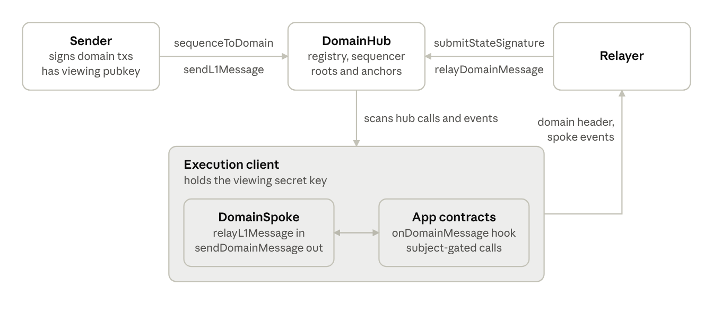

# Monad Domains Protocol

## Overview

A domain is a private execution environment whose transactions are ordered by the Monad L1 but whose contents only the domain's execution clients can read. Every domain transaction is submitted to the L1 as ciphertext, the L1 orders it, and the domain client decrypts and executes it off the L1's critical path.

The core protocol and its actors are as follows:

| Component | Where | Role |
| --- | --- | --- |
| DomainHub | L1, one instance | Registry of domains, transaction sequencer inbox, store of attested state roots and outbound message anchors, L1 inbox and outbox for messages |
| DomainSpoke | One instance at each domain | Receives L1-origin messages as system transactions, records domain-origin messages, holds the access-control rules the client enforces |
| Domain execution client | Off-chain, per domain | Modified Monad node. Derives the domain's blocks from hub events, decrypts payloads with the viewing secret key, executes, serves the domain header |
| Operator | Off-chain key | Registers the domain, relay messages |
| Validators | Off-chain keys | Sign state transitions. The hub advances the domain's state root once a quorum has signed the same transition |



Senders and the relayer only ever talk to the hub. The client reads the hub to derive every domain block, and the relayer carries domain headers and message anchors back up.

End to end: a sender encrypts a signed domain transaction to the domain's viewing key and hands the ciphertext to the hub. The domain client sees the sequencing event, decrypts, and executes the transaction in the next domain block. For message passing from domain -> L1, the operator merkleizes pending messages into an anchor, validators sign a digest binding the new state root to that anchor, and once the hub holds a quorum of signatures anyone can prove a message against the anchor and have the hub execute or forward it. Messages from L1 to a domain need no proof. The hub records them as events and the client injects one system transaction per event.

## Registering a domain

A domain is identified by its chain ID. A domain is created by calling `registerDomain` on the hub. Starting a domain should include the following three steps:

1. **Generate the viewing keypair.** A P-256 key. The secret key goes to every execution client that will serve the domain. The public key is used by users to encrypt domain transactions.
2. **Configure the execution clients.** Each replica is started with the domain's chain ID, the address its spoke will have, and the key file, plus the hub address as the sequencer contract. Every replica must hold the same secret key to decrypt the ciphertext.
3. **Deploy the spoke inside the domain.** The spoke is a contract in the domain's own state, not on the L1. Its creation transaction is sequenced through the hub like any other domain transaction.

## Transactions and Message passing

Everything that enters a domain is pushed by the protocol from L1 events.

**Sequenced transactions.** A domain transaction is an ordinary EIP-1559 transaction signed with the domain chain ID, with zero value. Its encrypted bytes are passed to `sequenceToDomain` on the hub, and any value attached is forwarded to the operator as a non-refundable fee. The execution client scans every L1 block for calls to the hub with that selector, decrypts the payload, and executes all eligible transactions of one L1 block as one gasless domain block against the domain state at the parent L1 height. No gas is charged on the domain.

**L1 to domain messages.** A call to `sendL1Message` on the hub records an event carrying the target and payload. The execution client derives one system transaction per event and calls `relayL1Message` on the spoke. Failed messages can be retried with a higher gas limit.

**Domain to L1 messages.**

1. A domain contract calls `sendDomainMessage(destinationChainId, to, data)` on the spoke. The spoke builds an envelope of source chain, destination chain, sender, target and the payload.
2. The operator sequences `finalizeDomainMessages` through the hub. The spoke computes the Merkle root of every pending messages.
3. The mssage anchor is posted on the hub contract when state root update is recorded.
4. Anyone calls `relayDomainMessage(message, anchor, proof)` on the hub to execute the message.

## State signature attestation

Validators periodically update domain state root in the hub contract. Each validator signs the digest the hub defines:

```
digest = keccak256(abi.encode(
    hub,                // this hub's address
    l1ChainId,
    domainChainId,
    stateNonce,         // the hub's current per-domain transition counter
    domainBlockNumber,  // L1 height the attested domain block committed at
    newStateRoot,       // domain state root at that block
    domainAnchor        // Merkle root of the outbound batch, or zero
))
```

The signature is plain secp256k1 ECDSA over the raw digest, submitted to `submitStateSignature`. When a quorum of signature is achieved, the hub marks the state root as recorded for the domain.

## Encryption

Every byte a domain executes reaches the L1 as HPKE ciphertext sealed to the domain's viewing key. The L1 orders ciphertext it cannot read, and the execution client is the only party that can open it.

**Profile.** A fixed RFC 9180 Base-mode suite, identical on both sides:

| Parameter | Value |
| --- | --- |
| KEM | DHKEM(P-256, HKDF-SHA256) |
| KDF | HKDF-SHA256 |
| AEAD | AES-128-GCM |
| info | the ASCII string `private-domain-hpke-rfc9180-v1` |
| Associated data | empty |

There are two types of encryptions:

- A sequenced transaction: the signed transaction bytes, including any EIP-2718 type prefix, with no extra RLP wrapper.
- An encrypted L1 to domain message: the 20-byte target address followed by the payload.

## Decryption and execution

Decryption happens inside the execution client, once per L1 block, as the first step of deriving the domain block.

For each L1 block the client, per served domain:

1. Scans the block's L1 transactions for calls to the hub's `sequenceToDomain` addressed to one of its domains.
2. Opens each payload with the domain's secret key: deserializes the encapsulated key, runs HPKE open with the fixed info string and empty associated data, verifies the AEAD tag, then checks and strips the frame byte. A payload that fails any of these is dropped with a warning. A plaintext payload is dropped too.
3. RLP-decodes the signed transaction, recovers its sender, and requires the signed chain ID to equal the domain ID, zero value, and a gas limit within the L1 envelope. A transaction whose recovered sender is the reserved system relayer is dropped.
4. Executes the ordinary L1 block against root state.
5. Scans the hub's receipts for message events of its domains and opens the encrypted ones the same way, recovering target and payload. An undecryptable message is dropped and its nonce is never delivered.
6. Executes the sequenced transactions, then the system delivery transactions, as one gasless domain block against the domain state at the parent L1 height.
7. Commits the domain state deltas, transactions and receipts alongside the L1 block. If L1 execution fails, the staged domain changes are discarded with it.

**Access control at execution time.** Before every call frame in a domain, the client makes a synthetic static call to the spoke's `canCall(caller, context, data)` with a 30,000 gas stipend and proceeds only on a canonical ABI true. The spoke checks the rule stored for the context contract and selector: open, subject match (the caller must equal the address at a configured calldata argument index), or readers only. Readers approved for that contract and selector bypass either restriction. This is primarily used for RPC read access control.
