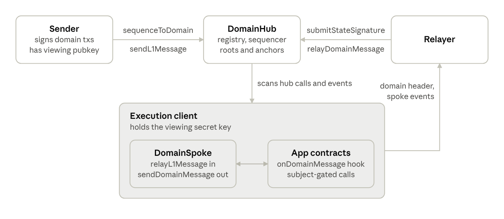

# Monad Domains Protocol

## Overview

A domain is a private execution environment whose transactions are ordered by the Monad L1 but whose contents only the domain's execution clients can read. Every domain transaction is submitted to the L1 as ciphertext, the L1 orders it, and the domain client decrypts and executes it off the L1's critical path.

The core protocol and its actors are as follows:

| Component | Where | Role |
| --- | --- | --- |
| DomainHub | L1, one instance | Registry of domains (validator set, quorum, fee recipient, encryption public key, checkpoint interval), transaction sequencer inbox, store of attested block hashes and outbound message anchors, L1 inbox and outbox for messages |
| DomainSpoke | One instance at each domain | Receives L1-origin and forwarded messages as system transactions, records domain-origin messages by nonce and seals the ones bound for another domain, holds the encryption public keys of other domains and the access-control rules the client enforces |
| Domain execution client | Off-chain, per domain | Modified Monad node. Derives the domain's blocks from hub events, decrypts payloads with the encryption secret key, executes, serves the domain header |
| Validators | Off-chain keys, one per replica | Sign checkpoints: the hash of the domain's last block at a scheduled L1 height together with the root of the domain-origin messages recorded since the previous checkpoint. The hub advances once a quorum signed the same checkpoint |



Senders and validators only ever talk to the hub. The client reads the hub to derive every domain block, and validators carry domain headers and message anchors back up.

End to end: a sender encrypts a signed domain transaction to the domain's encryption public key and hands the ciphertext to the hub. The domain client sees the sequencing event, decrypts, and executes the transaction in the next domain block. For message passing from domain -> L1, every validator independently signs the next scheduled checkpoint, whose anchor is the Merkle root of the messages recorded since the previous one. Once the hub holds a quorum of signatures anyone can prove a message against the anchor and have the hub execute or forward it. Messages from L1 to a domain need no proof. The hub records them as events and the client injects one system transaction per event.

## Registering a domain

A domain is identified by its chain ID. A domain is created by calling `registerDomain(domainChainId, validators, quorum, feeRecipient, encryptionPubKey, checkpointInterval, maxUnattestedPeriods)` on the hub. Starting a domain should include the following three steps:

1. **Generate the encryption keypair.** An X25519 key. The secret key goes to every execution client that will serve the domain. The public key is registered on the hub: users encrypt domain transactions to it, and other domains seal their messages to it. A domain registered without one cannot receive messages from other domains.
2. **Configure the execution clients.** Each replica is started with the domain's chain ID, the address its spoke will have, and the key file, plus the hub address as the sequencer contract. Every replica must hold the same secret key to decrypt the ciphertext.
3. **Deploy the spoke inside the domain.** The spoke is a contract in the domain's own state, not on the L1. Its creation transaction is sequenced through the hub like any other domain transaction.

## Transactions and Message passing

Everything that enters a domain is pushed by the protocol from L1 events.

**Sequenced transactions.** A domain transaction is an ordinary EIP-1559 transaction signed with the domain chain ID, with zero value. Its encrypted bytes are passed to `sequenceToDomain` on the hub with a fee, which the hub forwards to the domain's fee recipient. The fee buys `fee / DOMAIN_GAS_PRICE` gas, capped at the L1 block gas limit, and the transaction executes only if its gas limit is within that. The execution client derives the transactions of each L1 block from the hub's `DomainTransactionSequenced` events in its receipts, decrypts them, and executes all eligible ones as one gasless domain block against the domain state at the parent L1 height. No gas is charged on the domain.

**Fees.** Every sequencing and message call pays its fee in the L1 native token at the hub's fixed `DOMAIN_GAS_PRICE`, which the execution client mirrors. A sequencing call must pay at least `minSequencingFee(payload length)`: the price of 21,000 gas plus 10 gas per payload byte, so no input is free. The hub sells at most `DOMAIN_BLOCK_GAS_LIMIT` gas per domain per L1 block, across sequencing and messages; a call that would exceed it reverts.

**L1 to domain messages.** A call to `sendL1Message` on the hub records an event carrying the target, the payload and the fee, which must be at least `minDeliveryFee(payload length)`. The execution client derives one system transaction per event, with the gas the fee bought as its gas limit, and calls `relayL1Message` on the spoke. The spoke forwards all but `DELIVERY_GAS_RESERVE` of that gas to the target, so a target that fails or runs out of gas is still recorded as failed. Anyone can retry a failed message with `retryL1Message` and a higher gas limit.

**Domain to L1 messages.**

1. A domain contract calls `sendDomainMessage(destinationChainId, to, data, salt)` on the spoke. For the L1 the spoke builds an envelope of source chain, destination chain, sender, target, salt and the payload. For another domain it builds a sealed envelope instead, described below.
2. A batch is defined by two consecutive checkpoints: the message IDs recorded between them, in nonce order, are the leaves of a merkle tree whose root is the anchor. The tree hashes sorted pairs with keccak256, so proofs verify with OpenZeppelin `MerkleProof`, and promotes an odd node unchanged to the next level; a single message is its own root.
3. Validators sign the anchor together with the block hash. Once a quorum signed, the hub records the anchor.
4. Anyone calls `relayDomainMessage(message, anchor, proof)` on the hub to execute the message. A message to another domain is queued for that domain instead, and the caller attaches its delivery fee.

**Domain to domain messages.** A message to another domain takes the same four steps, but the L1 only ever sees ciphertext.

1. The spoke seals `abi.encode(sender, target, payload)` to the destination's encryption public key through the client's encryption precompile, and records an envelope whose sender, target and salt are zero and whose data is the ciphertext. It reverts if it does not hold the destination's key, or if the precompile returns something no longer than the plaintext.
2. The hub forwards a proven envelope as an `EncryptedMessageRecorded` event carrying the source chain, the source nonce and the ciphertext, under the destination's next delivery nonce. It rejects an envelope to a domain that names a sender, a target or a salt, and one bound for a domain without an encryption public key.
3. The destination client opens the ciphertext and delivers the sender, target and payload it holds through `relayL1Message`, as it delivers an L1 message.

**Encryption public keys of other domains.** A spoke seals to the keys it stores. Anyone calls `sendEncryptionPubKey(domainChainId, spoke, keyChainId)` on the hub with a delivery fee, and the hub records the registered key of `keyChainId` as an L1 message from itself to that spoke. The spoke stores a key only from a delivery whose source is the L1 and whose sender is the hub.

**Receivers.** A receiver must do all its work or revert. The sender does not set the gas of a delivery: on the L1 it is whatever the relayer supplies, in a domain it is what the attached fee bought, and a retry runs with its caller's gas. A callback that reverts leaves the message retryable, while one that returns normally consumes it for good. So a receiver that carries on after a failed inner call can be given just enough gas to finish without that call, and the message is lost.

**Input queue.** The hub also appends every sequenced transaction and message to the domain's input queue, a circular buffer in its own storage that holds the inputs the latest attested checkpoint does not cover; a quorum attesting a checkpoint releases the inputs up to its height. A sequencing or message call reverts if its input does not fit in the queue, or if it would open a checkpoint period `maxUnattestedPeriods` or more past the oldest one still unattested, so a domain whose validators stop attesting stops accepting inputs. The inputs of one L1 block may take at most `DOMAIN_BLOCK_WORD_LIMIT` words of the queue, about 0.4 MB and a tenth of its size; a call that would exceed that reverts.

## Checkpoint attestation

Validators attest checkpoints on a schedule. The hub accepts a checkpoint height that is a multiple of the domain's `checkpointInterval`, above the hub's last attested height. For a new domain that height starts at the last such multiple below the registering L1 block, so the first checkpoint covers that block.

Each validator signs the EIP-712 digest the hub defines, with domain `{name: "MonadDomainHub", version: "1", chainId: l1ChainId, verifyingContract: hub}` and the struct

```
StateTransition(
    uint64  domainChainId,
    uint256 stateNonce,         // the hub's current per-domain transition counter
    uint64  domainBlockNumber,  // the checkpoint's L1 height
    bytes32 newBlockHash,       // hash of the domain's last block at or before that height
    bytes32 domainAnchor        // Merkle root of the batch, or zero
)
```

**Syncing from a checkpoint.** The attested block hash and the input queue are all an execution client needs from the L1 to start without the domain's history. It gets the domain state at the checkpoint from any source and checks it against the attested hash: the block's header hashes to it, the state has the header's state root, and the hashes of the earlier blocks are in that state. It then derives the blocks after the checkpoint from the input queue. Before the first attestation the queue holds the domain from its registration.

## Encryption

Every domain transaction reaches the L1 as HPKE ciphertext sealed to the domain's encryption public key. The L1 orders ciphertext it cannot read, and the execution client is the only party that can open it.

**Profile.** A fixed RFC 9180 Base-mode suite, identical on both sides:

| Parameter | Value |
| --- | --- |
| KEM | DHKEM(X25519, HKDF-SHA256) |
| KDF | HKDF-SHA256 |
| AEAD | AES-128-GCM |
| info | empty |
| Associated data | `abi.encode("monad-transaction-encryption-v1", uint64 domainChainId)` for a sequenced transaction |

The plaintext of a sequenced transaction is the signed transaction bytes, including any EIP-2718 type prefix, with no extra RLP wrapper.

**Messages between domains.** The source domain's client seals them, in the encryption precompile at `0x…1a7e` that the spoke calls with the destination, its source nonce and the plaintext `abi.encode(address sender, address target, bytes payload)`. The precompile reads the destination's key from the spoke's `encryptionPubKeys` mapping (storage slot 7, one 32-byte word per domain) and binds the source domain, the destination and the source nonce as associated data, so a ciphertext opens only as that message. Every replica must compute the same ciphertext, so the randomness is derived rather than drawn: from the domain's secret seed, the caller, the destination key, the associated data and the whole plaintext. Leaving out the caller would let any contract reproduce a recorded ciphertext and confirm a guess of what it seals.

## Decryption and execution

Decryption happens inside the execution client, once per L1 block, as the first step of deriving the domain block.

For each L1 block the client, per served domain:

1. Scans the block's L1 transactions for calls to the hub's `sequenceToDomain` addressed to one of its domains.
2. Opens each payload with the domain's secret key: deserializes the encapsulated key, runs HPKE open with the associated data of the call's domain ID, verifies the AEAD tag, then checks and strips the frame byte. A payload that fails any of these is dropped with a warning. A plaintext payload is dropped too.
3. RLP-decodes the signed transaction, recovers its sender, and requires the signed chain ID to equal the domain ID, zero value, and a gas limit within the L1 envelope. A transaction whose recovered sender is the system relayer, or with an authorization that recovers to it, is dropped.
4. Executes the ordinary L1 block against root state.
5. Scans the hub's receipts for message events of its domains. A message forwarded from another domain is a ciphertext that domain sealed; the client opens it with the event's source chain, its own domain ID and the event's source nonce as associated data, recovering sender, target and payload. An undecryptable message is dropped and its nonce is never delivered.
6. Stores the parent domain block's hash in the domain state, in the block hash history contract of EIP-2935, as an L1 block does, then executes the sequenced transactions and the system delivery transactions as one gasless domain block against the domain state at the parent L1 height. `BLOCKHASH` reads the history contract.
7. Commits the domain state deltas, transactions and receipts alongside the L1 block. If L1 execution fails, the staged domain changes are discarded with it.

**Access control at execution time.** Before every call frame in a domain, the client makes a synthetic static call to the spoke's `canCall(caller, context, data)` with a 50,000 gas stipend and proceeds only on a canonical ABI true. The spoke forwards the question to the policy contract that the context contract's policy owner named with `setAccessPolicy`, and admits every caller of a contract without one. A policy implements `IDomainAccessPolicy.canCall` and decides from its own storage and the arguments. This is primarily used for RPC read access control.
